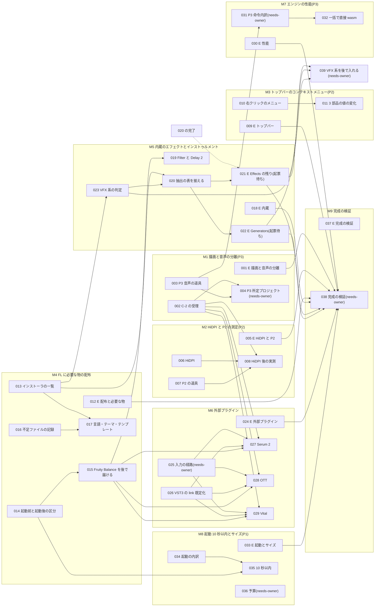

# 依存図(blocked_by)

矢印は「ブロッカー → 起動が待つ Issue」。Epic(枠)は、同じマイルストーンの子をまとめる。依存は、先に終わっていないと作業できない物だけにした(依頼者の指示。台帳 L-039 (6))。

注: 図の `E020X` は、`021`・`022` が 020 の完了を待つことを示す補助の節点。Epic 021・022 の子は、020 の完了の後に監査・受付が起票する。

## 起動の規則(`pm-work/workflow-design.md` の「5」に従う)

起動してよいのは、次を全て満たす Issue。
- 状態が open。ラベル `task` がある。
- ラベル `pm-hold`・`running`・`needs-owner`・`failed` が無い。`epic` が無く、sub-issue を持たない。
- `blocked by` の Issue のうち、open のものが 0 件。

ブロッカーが閉じると(`issues: closed`)、そのブロックされていた Issue が起動する。依存の付け外しは、Issue の編集(`edited`)かコメントで再評価される(設計「9」)。

## 依存の付け方(PM の手順。設計「9」の 1)

依存は、Issue を作った後に付けるので、作成の時点で起動させないために、全ての task に一時的に `pm-hold` を付けて作る。依存(`blocked by`)と sub-issue の関係を付けてから、ブロッカーの無い task の `pm-hold` を外す(`unlabeled` で起動する)。`needs-owner` の task は、依頼者の入力が来るまで外さない。

## ブロッカーが無く、すぐに起動する task(needs-owner を除く)

| 番号 | タイトル | 想定の所要(時間) |
|---|---|---|
| 002 | C-2 描画の別 Worker の受理を確かめ、残りを直す | 4 |
| 003 | P3 の音声の実測の道具 | 4 |
| 006 | HiDPI guest の画面を物理画素にし、DPI を guest に伝える | 6 |
| 007 | P2 の測定の道具 | 4 |
| 010 | 右クリックでメニューを画面に出し、項目の選択を engine に返す | 6 |
| 013 | インストーラ全件の一覧を作り、commit する | 4 |
| 014 | 起動前に取る物と、起動後に取る物を分ける | 8 |
| 016 | 起動時にホストに無かったファイルを記録する | 4 |
| 026 | VST3 の link を既定で有効にする | 6 |
| 034 | 起動の内訳を実測し、P1 の測り方を確定する | 3 |

合計: 10 件(想定 48 時間)。残りの task は、ブロッカーか needs-owner の解除を待つ。
