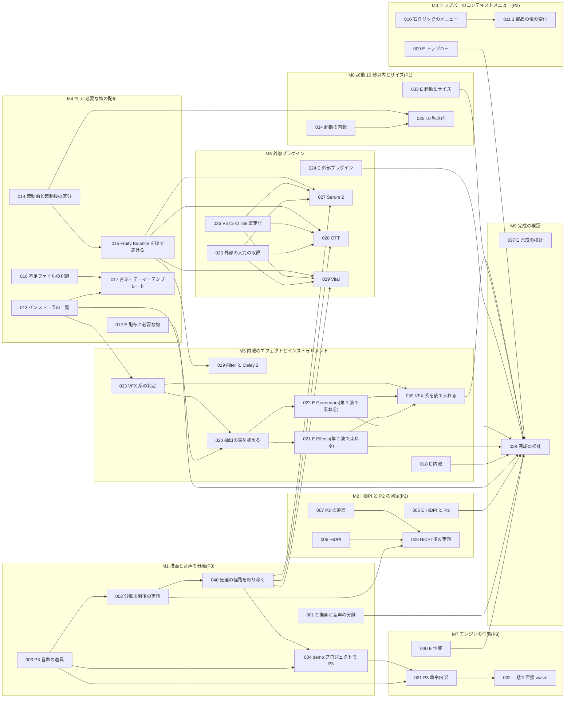

# 依存図(blocked_by)

矢印は「ブロッカー → 起動が待つ Issue」。Epic(枠)は、同じマイルストーンの子をまとめる。依存は、先に終わっていないと作業できない物だけにした(依頼者の指示)。

注: 021・022 は Epic。その子(束ねた Issue)は、WAVES.md の第 2 波で起票する。Epic は子が閉じた後に PM が閉じる。

## 起動の規則(`pm-work/workflow-design.md` の「5」に従う)

起動してよいのは、次を全て満たす Issue。
- 状態が open。ラベル `task` がある。
- ラベル `pm-hold`・`running`・`failed` が無い。`epic` が無く、sub-issue を持たない。
- `blocked by` の Issue のうち、open のものが 0 件。

ブロッカーが閉じると(`issues: closed`)、そのブロックされていた Issue が起動する。依存の付け外しは、Issue の編集(`edited`)かコメントで再評価される(設計「9」)。

## 依存の付け方(PM の手順。設計「9」の 1)

依存は、Issue を作った後に付けるので、作成の時点で起動させないために、全ての task に一時的に `pm-hold` を付けて作る。依存(`blocked by`)と sub-issue の関係を付けてから、ブロッカーの無い task の `pm-hold` を外す(`unlabeled` で起動する)。

## ブロッカーが無く、すぐに起動する task

| 番号 | タイトル | 想定の所要(時間) |
|---|---|---|
| 003 | P3 の音声の実測の道具を作る | 4 |
| 006 | HiDPI guest の画面を物理画素にし、DPI を guest に伝える | 6 |
| 007 | P2 の測定の道具を作る | 4 |
| 010 | 右クリックでメニューを画面に出し、項目の選択を engine に返す | 6 |
| 013 | インストーラ全件の一覧を作り、commit する | 4 |
| 014 | 起動前に取る物と、起動後に取る物を分ける | 8 |
| 016 | 起動時にホストに無かったファイルを記録する | 4 |
| 025 | 外部プラグインのインストーラを、作業の段から読めるようにする | 4 |
| 026 | VST3 の link を既定で有効にする | 6 |
| 034 | 起動の内訳を実測し、P1 の測り方を確定する | 3 |

合計: 10 件(想定 49 時間)。残りの task は、ブロッカーの解除を待つ。
